<h1 align="center">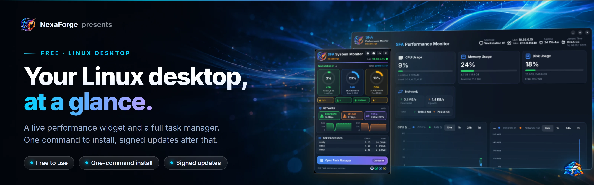</h1>

<p align="center">
  <a href="https://github.com/farhan6667/sfa-monitor/releases/latest"></a>
  
  
  
  <a href="LICENSE.md"></a>
</p>

**SFA Monitor is a free desktop performance widget and task manager for Linux. It shows CPU, memory, disk, network and GPU use on the desktop for every user, and opens a full monitor with End Task in one click or with Ctrl+Shift+Esc.** Built at NexaForge by Syed Farhan Ahmed.

One installer works on Kali, Debian, Ubuntu, Rocky Linux, AlmaLinux and RHEL. It finds your
distribution by itself, installs what it needs and keeps itself up to date from this page.

[Features](#features) • [Install](#install) • [Tour](#a-quick-tour) • [Updates](#updates) • [Uninstall](#uninstall) • [FAQ](#frequently-asked-questions)

## Watch the intro

https://github.com/user-attachments/assets/823123c0-691e-4ea9-ad30-fac95f1f3ef8

A one minute tour in 1080p: the desktop widget, the task manager and End Task, every page of the app, the themes, the one-command install and signed updates. [Download the MP4](docs/video/sfa-monitor-intro.mp4).

## At a glance

| | |
|---|---|
| **Widget** | CPU, RAM and disk gauges, network speed graph, top processes, a health strip for services, logins, ports and alerts |
| **Task manager** | Processes grouped by app with End Task, CPU, memory, disk, network and GPU pages, services, containers, security and logs, 7 days of history |
| **Install** | One command on every supported distribution, the setup turns on the repositories it needs |
| **Updates** | Checks this page twice a day, shows a notice, updates in one click after the admin password. Every update is signature checked |
| **Footprint** | The widget redraws itself, the full app runs only while its window is open, a small read-only collector feeds both |
| **Price** | Free for home and work use. [Licence](LICENSE.md) |

## Features

- **Always on the desktop.** A compact widget for every account that shows the machine name,
  LAN and WAN address, CPU, RAM and disk gauges, network up and down with a live graph, and the
  busiest processes. Close it with X and it comes back at the next login. Drag it anywhere.
- **Health strip.** Failed services, logged in users, new listening ports and alerts at a glance.
- **Task manager in one click.** Ctrl+Shift+Esc (or the big button on the widget) opens the
  full monitor. Processes are grouped by application, and End Task asks before it stops anything.
  Processes of other users ask for the admin password.
- **Real history.** CPU, memory, network and disk graphs for the last hour, day or week.
- **Services, containers, security, logs.** Read only views of systemd services, Docker
  containers, listening ports, logins and sudo use.
- **Screenshot button.** Select an area and annotate it. Uses Flameshot where it exists, and the
  desktop's own tool elsewhere.
- **Themes and layouts.** Four colour themes and Minimal, Default or Full widget layouts.
- **Your machine name.** Set a friendly name for the widget, protected by the admin password.

## Install

You need a Linux **desktop** (GUI) and an internet connection.

1. Download **`SFA-Monitor-Setup.run`** from the [latest release](https://github.com/farhan6667/sfa-monitor/releases/latest).
2. Open a terminal in your Downloads folder and run:

```sh
sudo bash SFA-Monitor-Setup.run
```

3. Wait for "Done". The first install takes a few minutes while it downloads conky, GTK and
   fonts. The widget then appears on its own.

The setup reads `/etc/os-release`, turns on EPEL and CRB on Rocky, Alma and RHEL (universe on
Ubuntu), and installs the right package. It stops on a machine without a desktop. A log of
every step is kept in `/var/log/sfa-monitor-setup.log`.

### Verify before you run (recommended)

Every release carries checksums and an Ed25519 signature. Two commands check both:

```sh
sha256sum -c SHA256SUMS.txt --ignore-missing
openssl pkeyutl -verify -pubin -inkey sfa-monitor.pem -rawin -in SFA-Monitor-Setup.run -sigfile SFA-Monitor-Setup.run.sig
```

The public key is in [SECURITY.md](SECURITY.md). The same key is inside your installed copy, so it
checks every update the same way.

### Supported systems

| Distribution | Versions | Desktop tested |
|---|---|---|
| Kali Linux | Rolling | XFCE (real desktop over RDP) |
| Debian | 13 and newer | test display |
| Ubuntu | 24.04 and newer | test display |
| Rocky Linux, AlmaLinux, RHEL | 9 | test display |
| Rocky Linux, AlmaLinux, RHEL | 10 | XWayland test display |

x86_64 only for now. Debian 12, Ubuntu 22.04 and older are not supported because their GTK is
too old. Every release is installed, started and removed on all of these before it is published.

### Prefer the package manager?

Each release also has the plain packages:

```sh
# Kali, Debian, Ubuntu
sudo apt install ./sfa-monitor_<version>_amd64.deb

# Rocky, Alma, RHEL 9 (turn on EPEL and CRB first)
sudo dnf install -y epel-release && sudo crb enable
sudo dnf install -y ./sfa-monitor-<version>-1.x86_64.rpm
```

On version 10, also install the `conky` and `xdotool` RPMs from the same release.

## A quick tour

Every page of the app, and the widget, on a demo machine (host name `nexaforge-demo`, sample log
lines, documentation IP addresses).

<p align="center">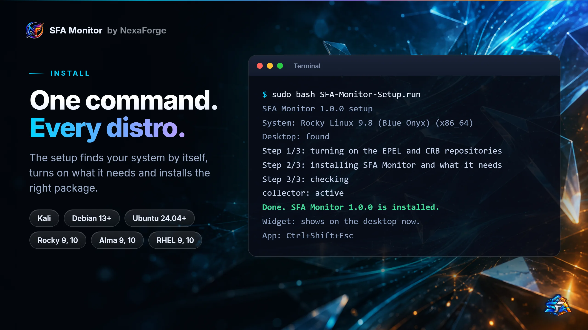</p>

### The desktop widget

<p align="center">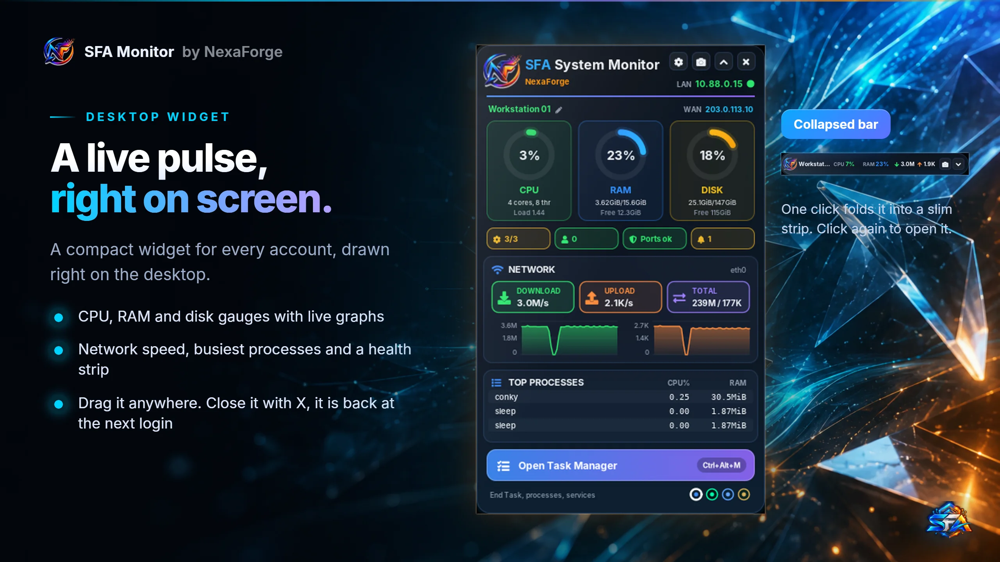</p>
<p align="center">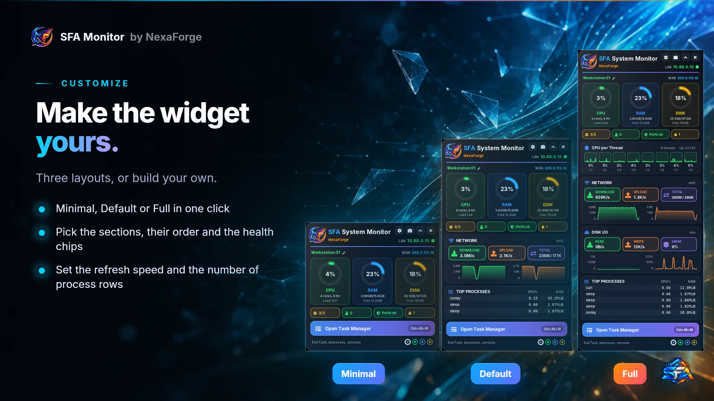</p>
<p align="center">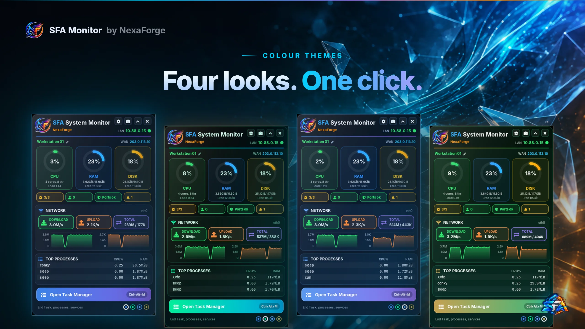</p>

### The task manager

<p align="center">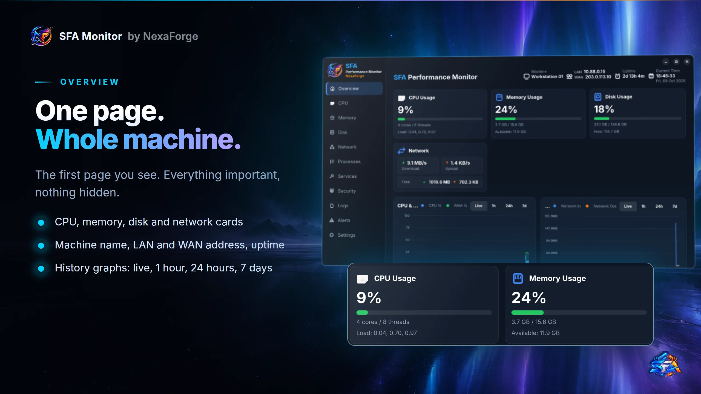</p>
<p align="center">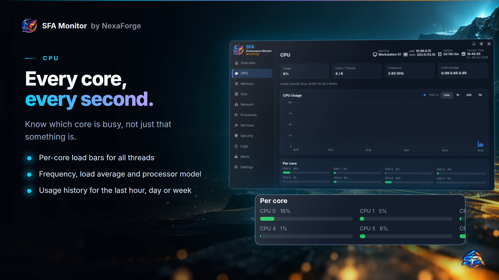</p>
<p align="center">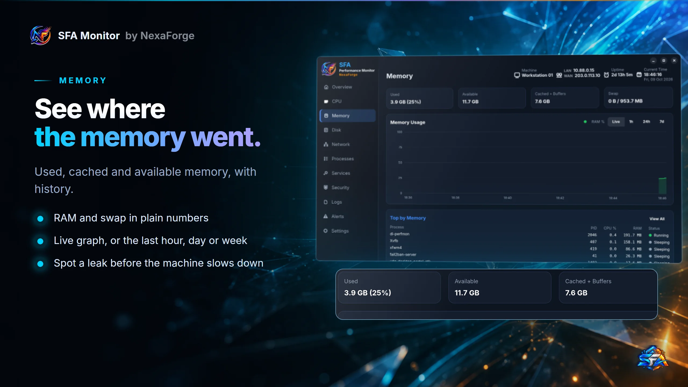</p>
<p align="center">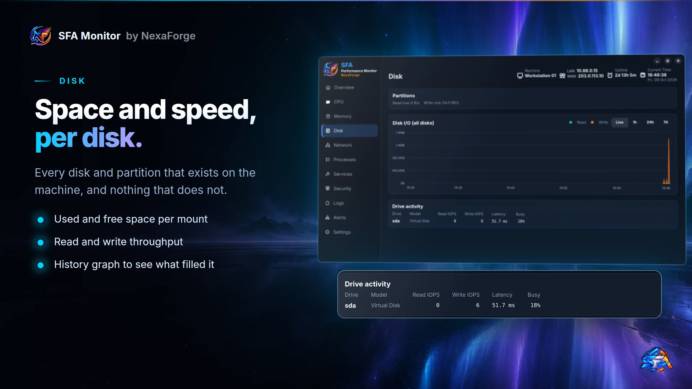</p>
<p align="center">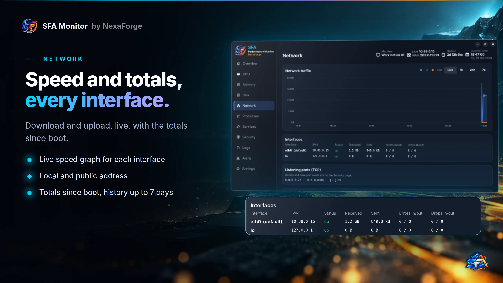</p>
<p align="center">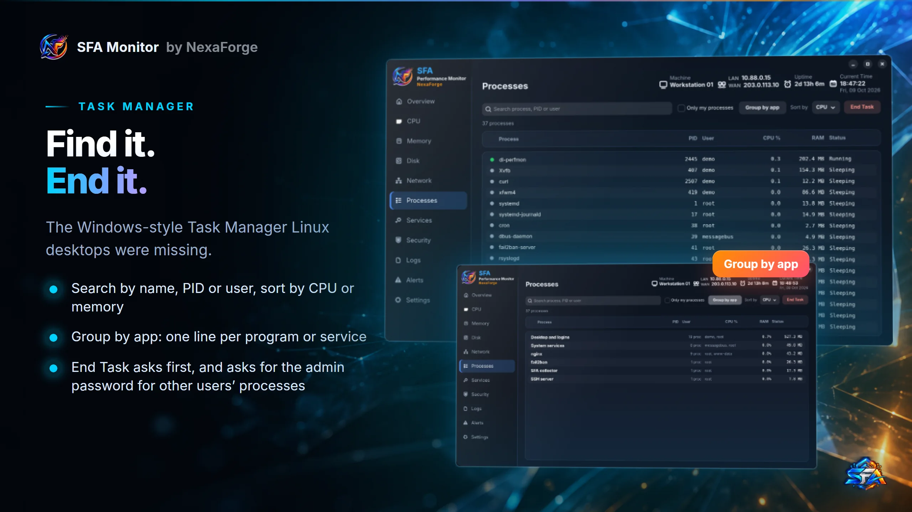</p>

### Services, security and logs

<p align="center">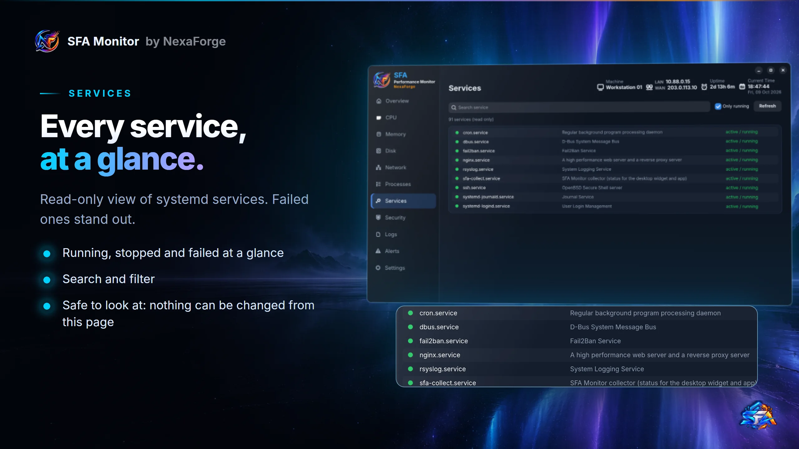</p>
<p align="center">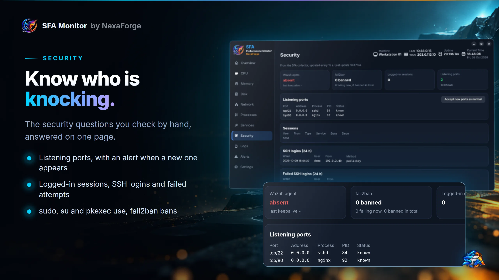</p>
<p align="center">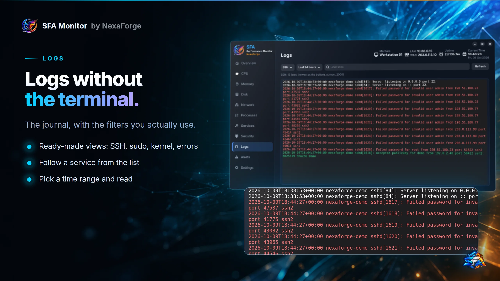</p>
<p align="center">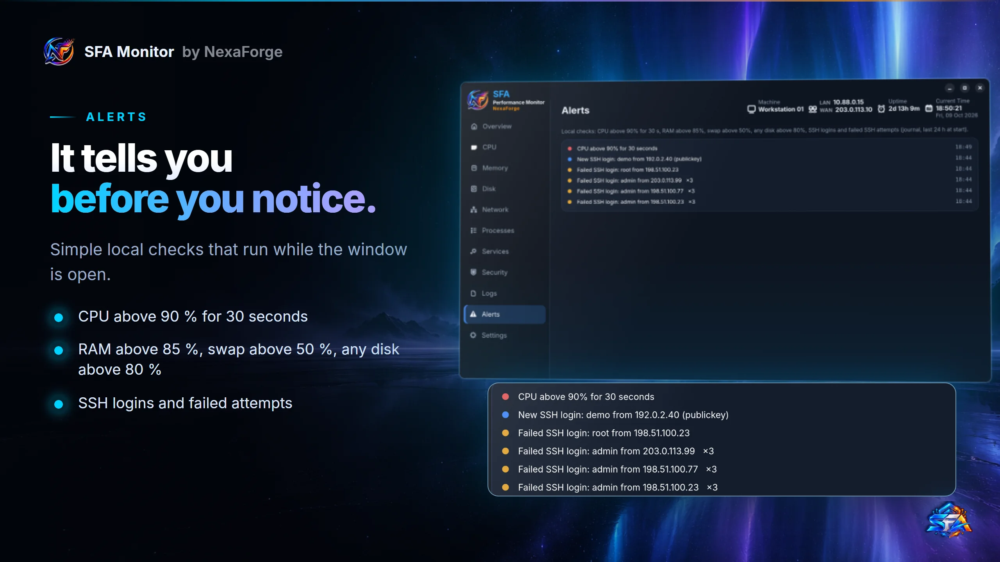</p>

### Updates

<p align="center">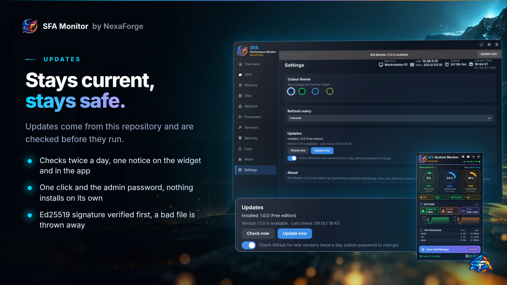</p>

Containers and GPU pages appear on their own when Docker or a GPU is present on the machine.

## Updates

SFA Monitor asks this repository twice a day whether a newer release exists. When one does, the
widget shows **Update available** and the app shows a banner. Click **Update now** and enter the
admin password. The setup file is downloaded, its Ed25519 signature is checked against the key
inside your installed copy, and only then is it run. A download that fails the check is thrown
away. Nothing is ever installed without your click.

To turn the check off: app > Settings > Updates, or set `enabled=0` in `/etc/sfa-monitor/update.conf`.

## Uninstall

```sh
sudo apt remove sfa-monitor     # Kali, Debian, Ubuntu (purge also removes settings and history)
sudo dnf remove sfa-monitor     # Rocky, Alma, RHEL
```

## What it changes on your machine

- Program files in `/opt/di-perfmon`, two fonts, a menu entry and two autostart entries (widget
  and screenshot helper).
- Two systemd units: `sfa-collect.service` (a small collector that only reads the system) and
  `sfa-update-check.timer` (twice a day).
- Settings in `/etc/sfa-monitor`, seven days of history in `/var/lib/sfa-monitor`.
- It opens no listening ports.
- Anything that changes the system (ending another user's process, starting or stopping a
  container, renaming the machine, installing an update) goes through `pkexec` and asks for the
  admin password each time.

`sudo apt remove sfa-monitor` or `sudo dnf remove sfa-monitor` takes all of it away.

## Privacy

SFA Monitor reads local system data and sends nothing about your machine anywhere. It opens no
network ports. It makes exactly two kinds of outgoing requests:

- the update check to `api.github.com`, twice a day (you can turn it off), and
- a lookup of your public IP address at `api.ipify.org` every 30 minutes, to show the WAN address
  on the widget.

The full app runs only while its window is open.

## Frequently asked questions

### What is SFA Monitor?
A free performance widget and task manager for Linux desktops. It shows how busy the computer
is at a glance and lets you end a stuck program, like the Windows Task Manager.

### Which Linux versions does it run on?
Kali Linux, Debian 13+, Ubuntu 24.04+, and Rocky Linux, AlmaLinux and RHEL 9 and 10, on x86_64,
with a desktop. One installer covers all of them.

### Does it work on a server without a desktop?
No. It is a desktop tool, and the setup stops on a machine without a graphical desktop.

### Is it free?
Yes, for home and work use. You may not resell it or put the installers on other download sites.
See the [licence](LICENSE.md).

### Is it open source?
No. It is free to use but the source code is not published. The third-party parts it builds for
RHEL 10 (conky, xdotool) are open source, and their build recipes are in [third_party](third_party/).

### How do updates work, and are they safe?
The app checks GitHub Releases twice a day and updates only when you click. Each update is
signed, and your installed copy refuses one whose signature does not match.

### How do I open the task manager?
Press Ctrl+Shift+Esc, click **Open Task Manager** on the widget, or open "SFA Performance
Monitor" from the menu. On remote desktop (RDP) the key may go to your own computer, so use the
button.

### I closed the widget. How do I get it back?
Log out and in again, or run `/opt/di-perfmon/sfa-widget &` in a terminal.

## Support

Questions, problems and ideas: open an [issue](https://github.com/farhan6667/sfa-monitor/issues)
or email nexaforge.services@gmail.com. When something fails during install, attach
`/var/log/sfa-monitor-setup.log`. Security problems: see [SECURITY.md](SECURITY.md).

If SFA Monitor saves you time, you can help keep it going. Hosting, tools, cloud credits and funding are all welcome, see the [sponsor page](https://github.com/farhan6667/farhan6667/blob/main/SPONSOR.md).

## License

Free to use, all rights reserved. See [LICENSE.md](LICENSE.md).

---

<div align="center">

<a href="https://nexaforge.eu.cc/">
  <picture>
    <source media="(prefers-color-scheme: dark)" srcset="docs/img/brand/nexaforge-lockup-dark.webp">
    
  </picture>
</a>

**Built at [NexaForge](https://nexaforge.eu.cc/)** by [Syed Farhan Ahmed](https://github.com/farhan6667)<br>
Cyber security · Vibe coding · Web development and IT infrastructure

[Website](https://nexaforge.eu.cc/) ·
[LinkedIn](https://www.linkedin.com/in/sfa6667) ·
[Portfolio](https://farhan6667.github.io/portfolio/) ·
[Email](mailto:nexaforge.services@gmail.com)

</div>
